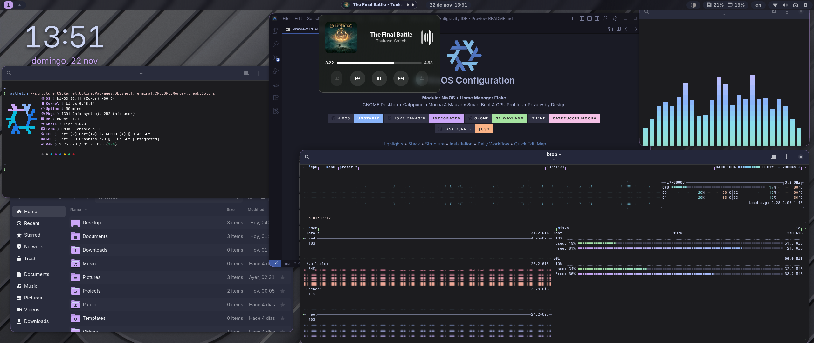
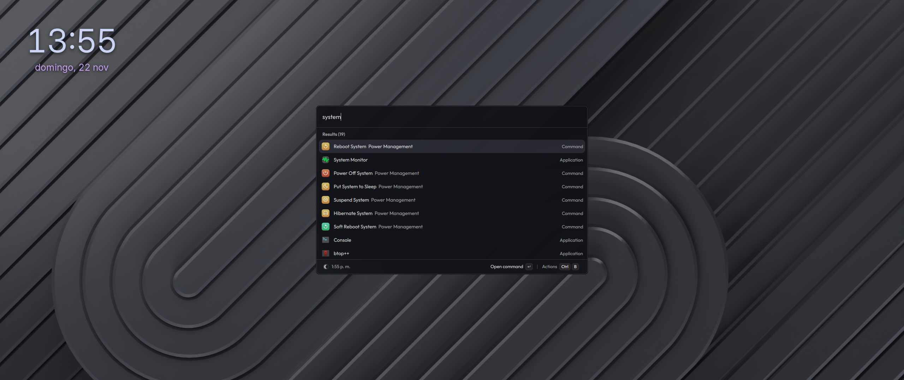
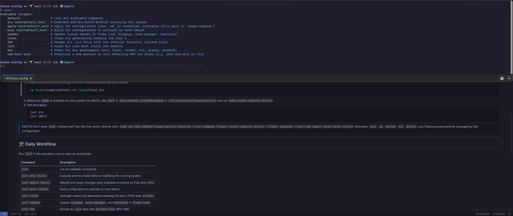
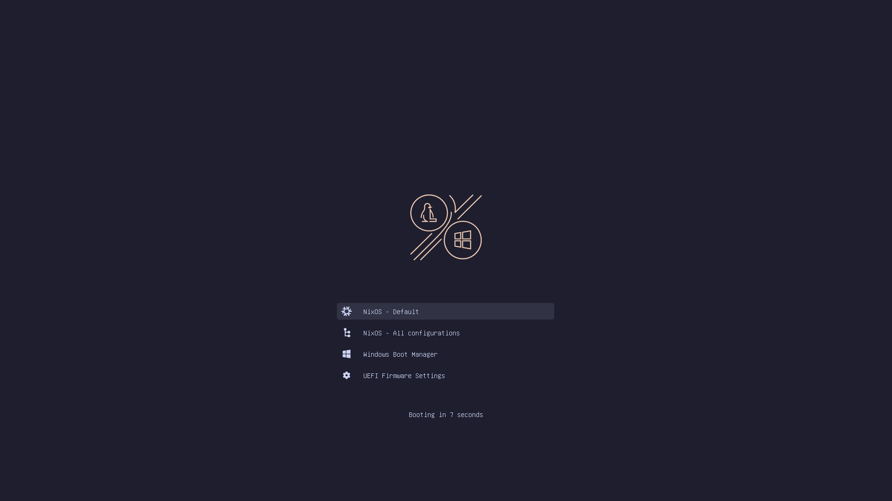
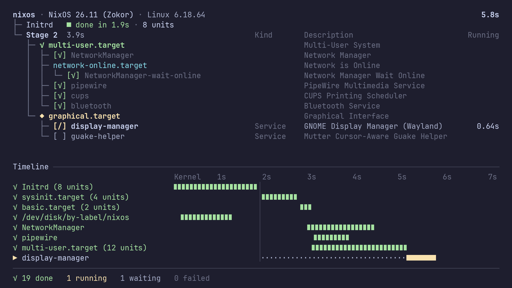

<div align="center">


<h1>❄️ NixOS Configuration</h1>

<p>
  <strong>Modular NixOS + Home Manager Flake</strong><br />
  GNOME Desktop • Catppuccin Mocha & Mauve • Smart Boot &amp; GPU Profiles
</p>

<p>
  
  
  
  
  
  <a href="https://github.com/EfrainPerez23/nixos-config/actions/workflows/ci.yml">
    
  </a>
</p>

<p>
  <a href="#-highlights">Highlights</a> •
  <a href="#-stack">Stack</a> •
  <a href="#-structure">Structure</a> •
  <a href="#-installation">Installation</a> •
  <a href="#-daily-workflow">Daily Workflow</a> •
  <a href="#-quick-edit-map">Quick Edit Map</a>
</p>

</div>

---

<div align="center">
  
</div>

<table>
  <tr>
    <td align="center" width="50%">
      <br />
      <sub><strong>Vicinae Launcher</strong> • <code>azclock</code></sub>
    </td>
    <td align="center" width="50%">
      <br />
      <sub><strong>Guake Drop-down</strong> • Fish, Starship &amp; <code>just</code></sub>
    </td>
  </tr>
  <tr>
    <td align="center" width="50%">
      <br />
      <sub><strong>GRUB Bootloader</strong> • Catppuccin Mocha Dual-Boot</sub>
    </td>
    <td align="center" width="50%">
      <br />
      <sub><strong>Bootvine</strong> • Live systemd boot tree</sub>
    </td>
  </tr>
</table>

<div align="center">
  <br />
  <sub><strong>Bootvine Live Boot Animation</strong> • Upstream demo from <a href="https://codeberg.org/wvhulle/bootvine">wvhulle/bootvine</a></sub>
</div>

## ✨ Highlights

- **💿 Smart Disk & Boot Detection** — `nixos/core/boot.nix` automatically detects `/boot/efi` (shared dual-boot disk) vs. `/boot` (dedicated NixOS disk), enables `os-prober` across one or multiple drives, pairs GRUB Catppuccin Mocha with **Bootvine**, and prints the detected layout on activation.
- **🎮 Reusable GPU Profiles** — Drop-in modules under `nixos/hardware/` for **Intel** (VA-API `iHD` + `i965`), **AMD** (`amdgpu` + Mesa/Vulkan), and **NVIDIA RTX** (open kernel module + Wayland/VA-API), selected per host with a single line (`my.hardware.gpu`).
- **🖥️ Multi-Monitor GNOME Patches** — Custom derivations in `pkgs/` (exposed via `pkgs.custom.*`) fixing multi-monitor Desktop Clock (`azclock`), multi-panel Dynamic Music Pill with shared Cava visualizer, and cursor-aware Guake placement on GNOME Wayland.
- **⚡ Modern Nix Tooling** — Built around **Flakes**, integrated **Home Manager**, **`nh`**, **`just`**, **`direnv` + `nix-direnv`**, **`nixfmt-tree`** (RFC-166), **`nil`**, **`statix`**, and **`deadnix`**.

---

## 🧩 Stack

| Component | Choice | Module |
| --- | --- | --- |
| **OS & Channel** | NixOS (`nixos-unstable`, Flakes) | [`flake.nix`](flake.nix) |
| **Bootloader & Splash** | GRUB UEFI (Catppuccin Mocha custom) + Bootvine | [`nixos/core/boot.nix`](nixos/core/boot.nix) |
| **Desktop Environment** | GNOME (Wayland) + 15 declarative extensions | [`nixos/desktop/gnome.nix`](nixos/desktop/gnome.nix) · [`home/desktop/gnome/`](home/desktop/gnome/) |
| **Theme & Palette** | Colloid Catppuccin Mocha Purple · Papirus Mauve · Catppuccin Cursors | [`home/desktop/gnome/theme.nix`](home/desktop/gnome/theme.nix) |
| **Drop-down Terminal** | Guake (XWayland + custom Mutter D-Bus helper) | [`home/desktop/guake.nix`](home/desktop/guake.nix) · [`pkgs/guake-helper/`](pkgs/guake-helper/) |
| **App Launcher** | Vicinae (user systemd daemon) | [`home/desktop/vicinae.nix`](home/desktop/vicinae.nix) |
| **Shell & Prompt** | Fish + Starship (Catppuccin Mocha) | [`home/terminal/fish.nix`](home/terminal/fish.nix) · [`home/terminal/starship.nix`](home/terminal/starship.nix) |
| **CLI Suite** | `btop`, `bat`, `eza`, `fastfetch`, `cava`, `nh`, `just`, `direnv` | [`home/terminal/cli.nix`](home/terminal/cli.nix) |
| **Apps & IDE** | Firefox, Google Chrome (GPU-aware flags), Antigravity IDE + CLI, Gradia | [`nixos/desktop/apps.nix`](nixos/desktop/apps.nix) |
| **Audio & Network** | PipeWire + `rtkit` · NetworkManager · CUPS | [`nixos/core/`](nixos/core/) |

---

## 📁 Structure

Each top-level directory has a single clear responsibility:

| Directory | Purpose |
| --- | --- |
| [`hosts/`](hosts/) | Per-machine control panels (`default.nix`, `hardware-configuration.nix`, machine-only quirks) |
| [`local/`](local/) | Public template (`example/default.nix`) + your private gitignored `local.nix` |
| [`nixos/`](nixos/) | System-level NixOS modules (`core/`, `hardware/`, `desktop/`) |
| [`home/`](home/) | User-level Home Manager modules (`desktop/`, `terminal/`) |
| [`pkgs/`](pkgs/) | Custom derivations & extension patches exposed under `pkgs.custom.*` |
| [`overlays/`](overlays/) | Overlay wiring `pkgs/` into `nixpkgs` |
| [`scripts/`](scripts/) | One-command machine bootstrapper (`new-host.sh`) |
| [`assets/`](assets/) | Static assets (desktop screenshots, custom GRUB dual-boot logo) |

<details>
<summary><strong>Click to expand full directory tree</strong></summary>

```text
.
├── flake.nix                  # Entry point: inputs, overlays, packages, formatter, devShell, hosts
├── flake.lock                 # Pinned dependency versions (zero personal data)
├── justfile                   # Modern task runner (`just dry`, `just apply`, `just fmt`, `just lint`)
├── .envrc                     # Auto-activates the devShell with `direnv allow`
├── statix.toml                # Nix linter configuration
├── local/                     # Personal settings (single directory)
│   ├── example/
│   │   └── default.nix        # Public generic template (tracked in Git)
│   └── local.nix              # Your real private values (gitignored)
├── scripts/
│   └── new-host.sh            # Auto-provisions new PCs (GPU, disks, local.nix, flake registration)
├── hosts/
│   └── laptop/
│       ├── default.nix        # Control panel: GPU profile & feature toggles (`my.*`)
│       ├── hardware-configuration.nix
│       └── wifi-intel.nix     # Intel 8265 PCI Wi-Fi recovery (laptop-specific)
├── nixos/
│   ├── core/                  # options, local, nix + nh, boot, locale, networking, audio, printing, users
│   ├── hardware/              # Reusable GPU profiles: intel.nix, amd.nix, nvidia.nix
│   └── desktop/               # fonts, gnome (GDM + system packages/extensions), apps
├── home/
│   ├── default.nix            # Home Manager entry point
│   ├── desktop/
│   │   ├── gnome/             # default, theme, keybindings, panel, effects, azclock
│   │   ├── guake.nix          # Autostart + dconf for Guake
│   │   └── vicinae.nix        # User systemd service + mutable vicinae.json
│   └── terminal/              # fish, starship, cli (btop, bat, fastfetch, cava, direnv)
├── pkgs/
│   ├── default.nix
│   ├── azclock-multimonitor/
│   ├── catppuccin-grub-custom/
│   ├── dynamic-music-pill/
│   ├── guake-helper/
│   └── guake-toggle/
├── overlays/
│   └── default.nix
└── assets/
    ├── bootvine.png
    ├── grub-logo.png
    ├── grub.png
    ├── guake.png
    ├── preview.png
    └── search.png
```

</details>

---

## 🚀 Installation

### Option 1 — New Machine (Intel, AMD, or NVIDIA RTX)

Clone the repo and run the provisioning script with any generic profile name (e.g. `pc-rtx`, `desktop-amd`, `work-laptop`):

```bash
git clone https://github.com/EfrainPerez23/nixos-config.git ~/Projects/nixos-config
cd ~/Projects/nixos-config

# Auto-detects GPU & disks, creates private local/local.nix, registers host, and applies first switch
./scripts/new-host.sh pc-rtx --apply
```

> [!TIP]
> Omit `--apply` if you want to inspect the generated `hosts/<profile>/default.nix` and `local/local.nix` before switching.

### Option 2 — Existing Profile (e.g. `laptop`)

1. Create your private local settings file from the template and edit your details:
   ```bash
   cp local/example/default.nix local/local.nix
   ```
2. Make sure **`just`** is installed on your system (on NixOS, add `just` to `environment.systemPackages` in `/etc/nixos/configuration.nix` and run `sudo nixos-rebuild switch`).
3. Test and apply:
   ```bash
   just dry
   just apply
   ```

> [!NOTE]
> Don't have `just` installed yet? Run the first switch directly with:
> `sudo env NIX_CONFIG="experimental-features = nix-command flakes" nixos-rebuild switch --flake .#laptop --override-input local path:./local`
> Afterward, `just`, `nh`, `nixfmt`, `nil`, `direnv`, and Flakes are permanently managed by this configuration.

---

## 🛠️ Daily Workflow

Run `just` in the repository root to view all commands:

| Command | Description |
| --- | --- |
| `just` | List all available commands |
| `just dry [host]` | Evaluate and dry-build without modifying the running system |
| `just apply [host]` | Rebuild and apply changes (also available anywhere as Fish alias `nrs`) |
| `just boot [host]` | Build configuration to activate on next reboot |
| `just clean` | Garbage-collect old generations keeping the last 3 (Fish alias `nclean`) |
| `just update` | Update `nixpkgs`, `home-manager`, and `bootvine` in `flake.lock` |
| `just fmt` | Format all `.nix` files with `nixfmt-tree` (RFC-166) |
| `just lint` | Audit Nix code with `statix` and `deadnix` |
| `just dev` | Enter the Nix development shell |
| `just new-host <name>` | Provision a new machine profile automatically |

### Development Environment (`devShell` + `direnv`) & CI

```bash
direnv allow   # Auto-loads the devShell on directory entry
just fmt       # Format all Nix files
just lint      # Run statix + deadnix + shellcheck
```

GitHub Actions & automation under [`.github/`](.github/):
- **[`workflows/ci.yml`](.github/workflows/ci.yml)** *(on pushes to `main`, Pull Requests & manual dispatch)* — runs privacy guard (`local/local.nix` never tracked), `nix fmt --fail-on-change`, `statix`, `deadnix`, `shellcheck`, evaluates all `nixosConfigurations`, and builds all custom packages/patches in `pkgs/`.
- **[`workflows/update-flake-lock.yml`](.github/workflows/update-flake-lock.yml)** *(weekly on Mondays & manual dispatch)* — opens an automated PR updating `flake.lock`.
- **[`dependabot.yml`](.github/dependabot.yml)** *(weekly on Mondays)* — groups and updates GitHub Actions versions automatically.

---

## 🗺️ Quick Edit Map

<details>
<summary><strong>Click to see where to edit every part of the system</strong></summary>

| What you want to change | File |
| --- | --- |
| Username, full name, hostname, timezone, locale | `local/local.nix` *(private, gitignored)* |
| Toggle GNOME, Guake, Vicinae, browsers, Antigravity | [`hosts/laptop/default.nix`](hosts/laptop/default.nix) |
| GPU profile (`intel` / `amd` / `nvidia`) | [`hosts/laptop/default.nix`](hosts/laptop/default.nix) · [`nixos/hardware/`](nixos/hardware/) |
| Laptop-specific Intel Wi-Fi recovery | [`hosts/laptop/wifi-intel.nix`](hosts/laptop/wifi-intel.nix) |
| GRUB, systemd-boot, EFI auto-detection, Bootvine | [`nixos/core/boot.nix`](nixos/core/boot.nix) |
| Flakes, `nh`, garbage collection | [`nixos/core/nix.nix`](nixos/core/nix.nix) |
| System desktop apps or browser flags | [`nixos/desktop/apps.nix`](nixos/desktop/apps.nix) |
| GNOME keyboard shortcuts | [`home/desktop/gnome/keybindings.nix`](home/desktop/gnome/keybindings.nix) |
| GTK theme, icons, cursor, dark mode | [`home/desktop/gnome/theme.nix`](home/desktop/gnome/theme.nix) |
| Top bar (Dash to Panel, Space Bar, Vitals, Music Pill) | [`home/desktop/gnome/panel.nix`](home/desktop/gnome/panel.nix) |
| Blur, rounded corners, Coverflow, animations | [`home/desktop/gnome/effects.nix`](home/desktop/gnome/effects.nix) |
| Multi-monitor desktop clocks | [`home/desktop/gnome/azclock.nix`](home/desktop/gnome/azclock.nix) |
| Guake drop-down terminal | [`home/desktop/guake.nix`](home/desktop/guake.nix) |
| Fish aliases or plugins | [`home/terminal/fish.nix`](home/terminal/fish.nix) |
| Starship prompt | [`home/terminal/starship.nix`](home/terminal/starship.nix) |
| `btop`, `bat`, `fastfetch`, `cava`, `direnv` | [`home/terminal/cli.nix`](home/terminal/cli.nix) |
| Custom packages & extension patches | [`pkgs/`](pkgs/) |

</details>
